# DSS5105 Capstone 2026 · Team 6

**Track 2: The Quick-Response Subcontracting Desk** — primary objective: **minimise lateness**.

[](https://github.com/DSS5105-Capstone-2026-Team6/DSS5105-Capstone-2026-Team6/actions/workflows/tests.yml)


> The factory (SweaterCo) farms out batches to 8 outside workshops when it is full.
> This system answers the dispatcher's three questions for every incoming order —
> *can they make it, can they take it now, are they allowed to* — makes the
> allocation, and leaves an auditable record with the reasoning attached.

**Live** · [Streamlit App](https://dss5105-capstone-2026-team6-yrcuaguw78h57dg9dc4pmi.streamlit.app) · [Telegram Bot](https://t.me/Ddispatcherr_bot)
**Docs** · [Allocator](docs/ALLOCATOR.md) · [Evaluation](docs/EVALUATION.md) · [Deployment](docs/DEPLOYMENT.md) · [Shared DB](docs/SHARED_DATABASE.md) · [Splits](docs/SPLITS.md)

## Architecture

Two thin front-ends, one deterministic core, one ledger. The LLM only ever
emits JSON tool-call lists — every number comes from a tool.

```mermaid
flowchart LR
    TG["Dispatcher<br/>Telegram"]:::front
    WEB["Dispatcher<br/>Web browser"]:::front

    subgraph CLOUD["Hosting"]
        BOT["Telegram Bot<br/>adapter/<br/>long polling<br/>UptimeRobot keep-alive"]:::front
        UI["Streamlit App<br/>app/<br/>sandbox by default<br/>Reset and connect"]:::front
    end

    subgraph CORE["core package · desk — single source of truth"]
        DESK["DispatchDesk<br/>handle_message → Decision<br/>confirm → record"]:::core
        PARSER["llm_parser<br/>message → JSON<br/>orders · intent · constraints"]:::core
        AGENT["agent.py<br/>tool-calling loop · temp 0"]:::core
        TOOLS["tools.py · 10 tools<br/>lookup_order · check_eligibility<br/>get_queue · estimate_delivery<br/>rank_candidates · probe_overload<br/>earliest_feasible · split_options<br/>flag_at_risk · update_performance"]:::core
        ALLOC["allocator<br/>4 objectives<br/>lateness · defects · cost · hybrid"]:::core
        ROUTER["router<br/>tool log → behaviour<br/>allocate · refuse · impossible<br/>ask · answer · no_data"]:::core
        CONF["confirmation<br/>fast path yes or cancel<br/>API classifier · fail closed"]:::core
        AUDIT["audit<br/>transactional ledger<br/>UNIQUE order_id"]:::core
        PERF["performance<br/>returned batches →<br/>learned capacity"]:::core
        BUDGET["budget<br/>hourly · daily caps"]:::core
        STORE["storage<br/>SQLite or pooled PG<br/>pipeline · advisory lock"]:::core
    end

    LLM[("LLM APIs<br/>DeepSeek · GPT · Claude<br/>JSON tool calls only")]:::llm
    LITE[("Local SQLite<br/>sandbox · default")]:::store
    SUPA[("Supabase PostgreSQL<br/>shared ledger · RLS")]:::store

    TG --> BOT --> DESK
    WEB --> UI --> DESK
    DESK --> AGENT
    PARSER --> AGENT
    AGENT <--> LLM
    AGENT --> TOOLS --> ALLOC --> ROUTER --> CONF --> AUDIT
    TOOLS --> PERF
    AUDIT --> STORE
    PERF --> STORE
    BUDGET --> STORE
    STORE --> LITE
    STORE --> SUPA
    BOT <--> SUPA
    UI <--> SUPA

    click DESK "https://github.com/DSS5105-Capstone-2026-Team6/DSS5105-Capstone-2026-Team6/blob/main/desk/desk.py"
    click PARSER "https://github.com/DSS5105-Capstone-2026-Team6/DSS5105-Capstone-2026-Team6/blob/main/desk/llm_parser.py"
    click AGENT "https://github.com/DSS5105-Capstone-2026-Team6/DSS5105-Capstone-2026-Team6/blob/main/desk/agent.py"
    click TOOLS "https://github.com/DSS5105-Capstone-2026-Team6/DSS5105-Capstone-2026-Team6/blob/main/desk/tools.py"
    click ALLOC "https://github.com/DSS5105-Capstone-2026-Team6/DSS5105-Capstone-2026-Team6/blob/main/docs/ALLOCATOR.md"
    click ROUTER "https://github.com/DSS5105-Capstone-2026-Team6/DSS5105-Capstone-2026-Team6/blob/main/desk/router.py"
    click CONF "https://github.com/DSS5105-Capstone-2026-Team6/DSS5105-Capstone-2026-Team6/blob/main/desk/confirmation.py"
    click AUDIT "https://github.com/DSS5105-Capstone-2026-Team6/DSS5105-Capstone-2026-Team6/blob/main/desk/audit.py"
    click PERF "https://github.com/DSS5105-Capstone-2026-Team6/DSS5105-Capstone-2026-Team6/blob/main/desk/performance.py"
    click BUDGET "https://github.com/DSS5105-Capstone-2026-Team6/DSS5105-Capstone-2026-Team6/blob/main/desk/budget.py"
    click STORE "https://github.com/DSS5105-Capstone-2026-Team6/DSS5105-Capstone-2026-Team6/blob/main/desk/storage.py"
    click BOT "https://github.com/DSS5105-Capstone-2026-Team6/DSS5105-Capstone-2026-Team6/blob/main/adapter/telegram_bot.py"
    click UI "https://github.com/DSS5105-Capstone-2026-Team6/DSS5105-Capstone-2026-Team6/blob/main/app/streamlit_app.py"
    click SUPA "https://github.com/DSS5105-Capstone-2026-Team6/DSS5105-Capstone-2026-Team6/blob/main/docs/SHARED_DATABASE.md"

    classDef front fill:#d0ebff,stroke:#1971c2,stroke-width:1.5px,color:#1c2b3a
    classDef core fill:#f1f8fe,stroke:#339af0,stroke-width:1.5px,color:#1c2b3a
    classDef llm fill:#74c0fc,stroke:#1971c2,stroke-width:1.5px,color:#08263f
    classDef store fill:#339af0,stroke:#1971c2,stroke-width:1.5px,color:#ffffff
```



## Headline results

| Metric | Value | Where verified |
|---|---|---|
| Lateness (10 seeds, default / --stages) | normal **1.7% / 1.8%** late, **0.18 / 0.23** late days · shock **1.9% / 2.5%**, **0.18 / 0.30** | [docs/Tolerance_Scan.md](docs/Tolerance_Scan.md) |
| Chat behaviour accuracy (dev 30 / held-out 20) | **0.933 / 0.800** | [docs/EVALUATION.md](docs/EVALUATION.md) |
| Faithfulness (numbers traced to tool outputs) | **0.967 dev / 1.000 held-out** | [docs/EVALUATION.md](docs/EVALUATION.md) |
| Tool calls | 10 deterministic tools, LLM never does arithmetic | [docs/EVALUATION.md](docs/EVALUATION.md) |

The allocator ranks candidates under **four switchable objectives**:
**lateness** (expected days late, then earliest finish) · **defects**
(lowest defect risk first) · **cost** (cheapest among on-time shops,
lateness fallback) · **hybrid** (default — a tolerance plateau:
within `late_tol` of the best lateness, then lowest defect rate inside the
plateau). `late_tol = 0.5` was selected by the 2×2 scan across normal/shock
× default/stages. Detail: [docs/ALLOCATOR.md](docs/ALLOCATOR.md) & [docs/Tolerance_Scan.md](docs/Tolerance_Scan.md)

The desk itself: 10 deterministic tools · LLM intake (DeepSeek/GPT/Claude)
· code-assigned behaviour routing · a transactional allocation ledger (local
SQLite per session, or a shared Supabase PostgreSQL for web + bot) · learned
workshop performance · a Streamlit dispatcher UI (live queues, allocator
lens, world switch Apr-1/Jan-1, stages mode, shock trigger, LLM parser,
batch confirm) and a Telegram bot shell (one-tap commit buttons, /queue
charts, yes all).

## Full-120 timeline evaluation (rerun 11 Nov 2026)

All 120 requests in `data/dispatch_requests_full120.txt`, replayed in
`[Sent: ...]` order from 1 Jan as one timeline: stages on, periodic shocks
(one active workshop closed 14 days every other week, seed 5105), queues
drain with time and grow with every allocation. Code: `main` @ `e61d50d`;
model: OpenAI GPT 6 Luna; labels: `data/f_heldout.json` (unchanged).

| Metric | Result |
|---|---|
| Behaviour accuracy | **93/120 = 0.775** (0 API errors) |
| Mean latency | 7.5 s per request |
| Earlier notebook runs, for reference | 88/120 (GPT, 3 Nov; DeepSeek, 10 Nov) |

| Request kind | Correct | | Request kind | Correct |
|---|---|---|---|---|
| ambiguous | 16/16 | | missing | 11/12 |
| ineligible | 16/16 | | impossible | **1/12** |
| complete | 27/28 | | unanswerable | **0/12** |
| constraint | 22/24 | | **total** | **93/120** |

23 of the 27 errors come from two kinds of request.

**1. Requests that change the order's completion date (impossible, 11 of 12 wrong).**
Each says the customer has moved delivery to the dispatch day itself, for
example F061: *"New delivery deadline is Feb 13, exactly the day we send it
out. We used to have until Mar 14."* No workshop can deliver the same day,
so the label is `impossible`. But the desk always takes the due date from
the order register. The model notices the conflict and says so ("the
register still has ORD-032 due Mar 14"), then checks feasibility against the
**old** date, which is easy to meet. Result: `allocate` 8 times, `ask` 3
times. Fix: add `due_date` to the parsed request and pass a deadline stated
in the message to `rank_candidates` / `earliest_feasible`, recording "deadline
from message, register says X".

**2. Questions the data cannot answer (unanswerable, 12 of 12 wrong).**
Invoice status, deposit, buyer phone number, QC report and so on. The model's
reply is right every time (e.g. "the order lookup doesn't include deposit
details"), but the behaviour is assigned by `desk/router.py`, not by the
reply. Two things go wrong there. Every full-120 message ends with a
`[Sent: YYYY-MM-DD]` tag, and `"sent"` is in `_ALLOC_MARKERS`, so every
message looks like a dispatch request; and most of these questions ("how much
deposit", "what street address") match none of the short `_QUERY_MARKERS`
anyway. The result is `ask` (10), `allocate` (1, F032, after the model called
`rank_candidates`) or `answer` (1), never `no_data`. Fix: strip the envelope
tag before routing, and detect data questions by pattern (or a small
classifier) instead of a keyword list.

**The other 4 errors:** F039 and F084 tell the desk to exclude a workshop;
the router treats a named, ruled-out workshop as a refusal, while the label
expects an allocation to the remaining shops. F015 has no new date but was
ranked anyway (`ask` → `allocate`), and F095 read *"Factory is full"* as a
workshop name and asked which one was meant.

### Requests for orders that are already completed

86 of the 120 requests name an order that the register marks **COMPLETE**,
and every one of those orders was completed *after* the request's sent date:
the factory finished them in-house. The replay asks "what if they had been
sent outside on that day", so the runner first resets them to
`IN_PROGRESS`; otherwise the desk would correctly refuse to dispatch a
finished order.

At first sight the completed orders look like the problem:

| Order named in the request | Correct |
|---|---|
| COMPLETE in the register | 62/86 (0.72) |
| still open in the register | 31/34 (0.91) |

But all 12 *impossible* requests and 10 of the 12 *unanswerable* ones name a
completed order, so the gap is mostly which kinds of request fall in each
group. Within the other five kinds the two groups score the same: **61/64
(0.95)** for completed orders vs **31/32 (0.97)** for open ones. The
completed status itself, after the reset, is not what causes the errors;
the deadline changes and the routing tag above are. One side effect remains:
the reset clears the in-house completion but keeps the register's stage, so
some replies describe a finished order as "in progress at the WASHING
stage" (e.g. F095).

Reproduce: `python eval/run_full120.py` (add `--limit 10` for a smoke test;
needs `OPENAI_API_KEY`). Output in `results/full120/`:
`full120_rerun_20261111_openai.jsonl` (decisions and tool logs),
`..._scores.json` (all numbers, one row per request) and `..._summary.md`.
Compared with the notebook, the script raises the API budget so a full run
does not stop part-way, rebuilds queues when resumed, uses a fresh ledger,
and keeps OldMill suspended instead of re-opening it every day.

## Project Structure

```
├── README.md                  # This file
├── docs/                      # ALLOCATOR (algorithm) · EVALUATION (routing, faithfulness) · FAILURE_ANALYSIS · DEPLOYMENT
├── data/                      # Track 2 dataset (shared simulator input)
│   ├── orders.csv             # 120 orders
│   ├── workshops.csv          # 8 workshop profile cards
│   ├── dispatch_requests.txt  # 30 chat-style allocation requests (NL inbox)
│   ├── dispatch_requests_heldout.txt  # 20 held-out requests (never tuned on)
│   ├── orders_stages.csv      # Optional --stages extension
│   ├── workshops_stages.csv   # Optional --stages extension
│   └── data_dictionary.md     # Column definitions
├── harness/
│   ├── simulate.py            # Shared evaluation harness — DO NOT MODIFY
│   ├── eft_benchmark.py       # EFT benchmark + accessory-reservation experiment
│   └── algorithm2.py          # Lateness-first hybrid allocator + tolerance scan
├── desk/                        # application core: state, audit, orchestration
│   ├── contracts.py             # structured records (Decision, AllocationRecord, ...)
│   ├── config.py                # central constants + the switchable world clock (Apr-1 / Jan-1)
│   ├── register.py              # OrderStore + WorkshopStore (shared data stores)
│   ├── tools.py                 # the 10 deterministic tools (no LLM) + tool registry
│   ├── performance.py           # learned workshop performance (roadmap §1.6, SQLite-backed)
│   ├── allocator.py             # Tool 5: the allocator — ranked candidates, objective as config
│   ├── agent.py                 # intake agent (tool-calling loop, temp 0; DeepSeek/GPT/Claude)
│   ├── router.py                # code-assigned behaviour: tool log -> Decision
│   ├── llm_parser.py            # semantic message parsing (JSON extraction), vs the rule splitter
│   ├── prompts/dispatcher.txt   # system prompt, dispatcher persona (Streamlit desk)
│   ├── prompts/group.txt        # system prompt, group-chat persona (Telegram bot)
│   ├── state.py                 # DeskState: chat-side queues (1 Apr snapshot, commits only)
│   ├── audit.py                 # AuditLog: transactional allocation ledger
│   ├── storage.py               # SQLite locally / pooled PostgreSQL when DISPATCH_DATABASE_URL is set
│   ├── budget.py                # shared API-call budgets (per hour/day)
│   ├── confirmation.py          # follow-up intent parsing (confirm/cancel/modify)
│   └── desk.py                  # DispatchDesk: handle_message() -> Decision, confirm() -> record
├── adapter/                   # Telegram bot shell around DispatchDesk
│   ├── session.py             # per-chat session: trigger filter + confirmation gate (pure, tested)
│   ├── telegram_bot.py        # python-telegram-bot wiring; zero business logic
│   └── charts.py              # /queue bar-chart photos (matplotlib, headless)
├── database/
│   └── supabase_schema.sql    # shared PostgreSQL schema (5 tables, RLS on)
├── scripts/
│   └── check_database.py      # read-only shared-DB connectivity check
├── app/
│   ├── streamlit_app.py       # entry: auth gate, get_desk, confirmation-flow core, main()
│   ├── theme/                 # design system: tokens (palette/badges), icons, styles (CSS), motion (scroll sync)
│   ├── components/            # leaf renderers: cards + queue bars, LLM parse view, ledger cache
│   ├── tabs/
│   │   ├── desk/              # Desk tab: intake (4 sources) -> dispatch loop -> worklist; cards; scenario preview
│   │   ├── dashboard.py       # queue timeline, allocator lens, capacity drift, objective map
│   │   └── records.py         # ledger view + demo reset
│   ├── rail/                  # right rail: world & shock, objective picker, live queues (5s fragment refresh)
│   ├── sidebar/               # chat log + returned-batch recorder
│   └── local_auth/            # remember-me localStorage component
├── eval/
│   ├── run_eval.py              # batch runner: inbox -> JSONL of Decisions (+ latency)
│   ├── score_run.py             # scores a run vs labels: behaviour / workshop / faithfulness
│   ├── replay_offline.py        # re-scores recorded runs on the current code, no API key
│   ├── shock.py                 # periodic shock calendar + shock-aware labels
│   └── faithfulness.py          # every number in the reply must trace to the tool log
├── results/                   # committed eval artefacts (inbox_*/heldout_* runs + scores)
├── tests/                     # pytest suite: one failure case per feature (289 tests)
└── pyproject.toml             # uv project, Python 3.11
```

## Sprint 3 — realism, polish, and one shared ledger

Key milestones since Oct 30 — who changed what, and what it bought us:

- **[SishuoZhou](https://github.com/orgs/DSS5105-Capstone-2026-Team6/people/SishuoZhou)** —
  owned the split-order engine and the one-tap dispatching UX:
  multi-workshop split ranking for impossible orders, the held-out review
  fixes (lookup filters, recommendation consistency), cards as confirm
  buttons and auto-scroll
  ([#20](https://github.com/DSS5105-Capstone-2026-Team6/DSS5105-Capstone-2026-Team6/pull/20)–[#35](https://github.com/DSS5105-Capstone-2026-Team6/DSS5105-Capstone-2026-Team6/pull/35),
  [docs/SPLITS.md](docs/SPLITS.md)) → far fewer clicks per order.
- **[GuanmingYang](https://github.com/orgs/DSS5105-Capstone-2026-Team6/people/beibei323)** —
  built the scenario preview end to end: Sunday closures, transport delay,
  seeded capacity noise, selectable start dates, and its own preview
  dialog ([#36](https://github.com/DSS5105-Capstone-2026-Team6/DSS5105-Capstone-2026-Team6/pull/36),
  [#55](https://github.com/DSS5105-Capstone-2026-Team6/DSS5105-Capstone-2026-Team6/pull/55))
  → ETAs that respect the real calendar.
- **[RuoxiZhou](https://github.com/orgs/DSS5105-Capstone-2026-Team6/people/chikD666)** —
  designed, built and deployed the shared Supabase PostgreSQL ledger:
  schema with RLS, the storage adapter with advisory-lock writers, and the
  acceptance suite incl. a real Telegram round-trip
  ([#38](https://github.com/DSS5105-Capstone-2026-Team6/DSS5105-Capstone-2026-Team6/pull/38),
  [docs/SHARED_DATABASE.md](docs/SHARED_DATABASE.md))
  → both front-ends read and write the same truth.
- **[XuantingWang](https://github.com/orgs/DSS5105-Capstone-2026-Team6/people/ADEdreambridge)** —
  hardened the desk: a one-tap Skip for duplicate orders on both Streamlit
  and the Telegram bot, code-ranked alternatives for refusals (R24), the
  failure-analysis doc with offline re-scoring, and the Streamlit deploy
  hotfix
  ([#56](https://github.com/DSS5105-Capstone-2026-Team6/DSS5105-Capstone-2026-Team6/pull/56),
  [#57](https://github.com/DSS5105-Capstone-2026-Team6/DSS5105-Capstone-2026-Team6/pull/57),
  [docs/FAILURE_ANALYSIS.md](docs/FAILURE_ANALYSIS.md))
  → workshop accuracy after the fixes: 0.842 → 0.895 dev, 0.692 → 0.846
  held-out.
- **[Xuehann](https://github.com/orgs/DSS5105-Capstone-2026-Team6/people/Xuehann)** —
  sprint planning and project leadership: milestone planning and task
  allocation, cross-workstream coordination and progress tracking,
  validation and test passes on the shared-ledger rollout and the UI
  changes, acceptance sign-off before each merge, and demo-day
  presentation coordination.
- **[Zhangruikai](https://github.com/orgs/DSS5105-Capstone-2026-Team6/people/Zhangruikai-rzha0162)** —
  UI adjustments (switchable objective panel, live queue bars, dashboard
  views) and the 120-request timeline evaluation with periodic shocks
  ([notebooks/full120_timeline_shock.ipynb](notebooks/full120_timeline_shock.ipynb),
  [eval/shock.py](eval/shock.py)).
- **[kimi](kimi.moonshot.cn/)** —
  [#37](https://github.com/DSS5105-Capstone-2026-Team6/DSS5105-Capstone-2026-Team6/pull/37),
  [#39](https://github.com/DSS5105-Capstone-2026-Team6/DSS5105-Capstone-2026-Team6/pull/39)–[#46](https://github.com/DSS5105-Capstone-2026-Team6/DSS5105-Capstone-2026-Team6/pull/46),
  [#60](https://github.com/DSS5105-Capstone-2026-Team6/DSS5105-Capstone-2026-Team6/pull/60):
  app/ reorganised by surface; bot proposal fix, one-tap buttons, `/queue`
  charts, yes all; DB pooling + version-gated cache + pipelined
  transactions + longer LLM timeout; batch confirm; sandbox mode; scenario
  button pinned; deployed and operates the bot on Render.
- **[Claude](https://claude.com)** —
  used by members across the team: multi-workshop split ranking and the
  held-out review fixes (with SishuoZhou), one-tap cards and the parser
  tab, duplicate-skip and failure replay with XuantingWang, and
  implementation support across GuanmingYang's, RuoxiZhou's and Xuehann's
  tasks.

## Safety and deployment

See [deployment and migration notes](docs/DEPLOYMENT.md) before upgrading.
The model tools are read-only. Human confirmation uses a transactional
allocation ledger; follow-ups update the pending proposal. Public
Streamlit deployments require `APP_PASSWORD`, and every provider requires its
own key (`DEEPSEEK_API_KEY`, `OPENAI_API_KEY`, `ANTHROPIC_API_KEY`). Server-side
API call budgets survive new sessions and Reset demo.

Storage modes: the Streamlit app starts in a **local sandbox** (session-local
SQLite; nothing touches shared data — safe for debugging and tests), and the
Records tab's **Reset & connect to shared DB** rebuilds the desk on the shared
Supabase ledger, the same one the Telegram bot always uses. With no cloud
database configured, everything falls back to local SQLite; a configured-but-
unreachable cloud database fails loudly instead of silently writing locally.
Existing JSONL audit records are imported once (duplicates skipped, first
record wins).

## Quick Start

Requires Python 3.11+ and [uv](https://docs.astral.sh/uv/). Copy `.env.example`
to `.env` and fill in `DEEPSEEK_API_KEY` (the chat smoke test and the UI's
dispatching need it) and `APP_PASSWORD` (the UI asks for it). The simulator,
benchmarks and tests run without any key. Never commit `.env`.

```bash
cp .env.example .env                        # then edit the values
uv sync                                     # install deps (generates uv.lock)
python harness/simulate.py                  # runs the three baselines (random / greedy_biggest / cheapest)
python harness/eft_benchmark.py --seeds 10  # EFT benchmark, normal + shock, averaged over 10 seeds
uv run pytest                               # tool unit tests (incl. failure cases)
uv run python desk/agent.py "R07: ORD-063 — 100 cardigans, make Apr 29."   # chat smoke test (needs DeepSeek key in .env)
uv run streamlit run app/streamlit_app.py   # the dispatcher UI
```

`harness/simulate.py` loads its data from `../data` — keep the `harness/` and `data/` directories as siblings.

## Team Members

-
