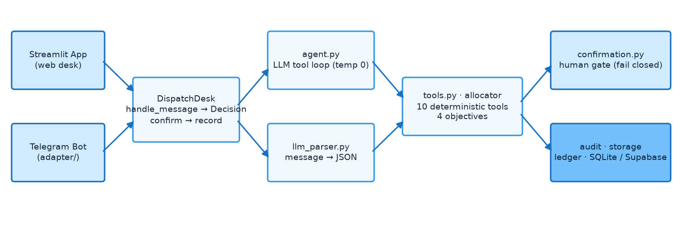

# Generative AI Beyond Content: Human-Gated Transactional Agents as a Transferable Pattern for Industrial Operations

**National University of Singapore — DSS5105 Capstone 2026, Track 2**

Zhou Sishuo · Zhang Ruikai · Dang Xuehan · Wang Xuanting · Yang Guanming · Zhuang Ruoxi

## Abstract

Enterprise adoption of generative AI has become near-universal, yet measurable
operational value remains concentrated in a small minority of deployments. This
paper argues that the gap is structural: most deployments generate content,
while the decisions that move money in industrial operations still live in
chat threads and human memory. Drawing on a working reference implementation —
a quick-response subcontracting desk that allocates production batches to
outside workshops under human confirmation with an auditable ledger — we
identify the underlying transferable pattern and evaluate adjacent industrial
domains where the same loop applies. Three opportunities emerge as low-hanging
fruit: field-service dispatch triage, freight exception handling in small
third-party logistics, and spot-buy RFQ triage in discrete manufacturing. Each
is supported by market evidence and a concrete implementation path that reuses
the reference architecture with minimal new engineering.

## 1. Introduction

Roughly nine in ten organisations report regular AI use in at least one
business function, and 44% say AI is scaling across the enterprise — up from
38% a year earlier [1]. Yet McKinsey's 2026 survey, pointedly titled *On the
road to ROI*, finds financial returns flat for a second consecutive year
[2]. The imbalance suggests that adoption breadth has outrun deployment
discipline — copilots and content generators are easy to buy, whereas the
operational decisions that consume the remaining budget (who takes this job,
at what price, by when) are rarely touched by generative systems at all. The
agentic wave now arriving in enterprise workflows (a market growing at 47.4%
CAGR through 2030 [3]) sharpens the question: which decisions may an agent
touch, and under what gate?

![Figure 1. Enterprise AI adoption versus realised value: regular use and enterprise-wide scaling keep climbing while financial returns stay flat for a second consecutive year (McKinsey State of AI 2026 [1][2]).](docs/assets/adoption_gap.png)

This asymmetry motivates a narrower question: which industrial workflows accept
generative AI without demanding either full autonomy (which enterprises
distrust) or mere summarisation (which competitors already supply)? We answer
from evidence rather than taxonomy. Our reference point is a production-grade
agent built for knitwear subcontracting: an LLM front-end that parses
free-form chat into structured requests, a deterministic tool layer that owns
all arithmetic, code-assigned behaviour routing, a human confirmation gate
before any commitment, and a transactional ledger that makes every allocation
auditable. Section 3 abstracts this pattern; Sections 4 and 5 apply it.

## 2. Background and market context

Spending signals confirm that industrial operations are investing, but along
conservative lines. AI in supply chain management was valued at approximately
$9.9B in 2025 with projections to $236B by 2035 [4], concentrated in
forecasting and visibility. AI in manufacturing stood near $4.2–5.9B in 2024
[5], dominated by predictive maintenance and inspection. Generative AI in
logistics remains nascent — $0.46B in the US in 2025, expected to reach $11.1B
by 2035 [6] — and field service management, at $5.1–6.1B in 2025 growing at
11–12.5% annually [7][8], is only beginning to absorb AI beyond scheduling
optimisation. The 2026 turn toward agentic workflows — from $5.2B in 2024
toward a projected $227B by 2034 [9], with early adopters reporting 20–30%
faster workflow cycles [10] — is arriving first in content and back-office
work, not in transactional operations. Enterprise surveys repeatedly cite
hallucination control and data provenance as the principal blockers to
scaling [2], which disciplines the design space: buyers pay for gates, not
autonomy.

## 3. A transferable pattern

The reference implementation decomposes dispatch into an LLM-readable front
and a machine-owned back. Free-form messages are parsed into structured
requests; a fixed set of deterministic tools answers all quantitative
questions; routing from tool output to behaviour is code, not prompt; writes
require explicit human confirmation; and every commitment lands in an
append-only ledger whose entries carry the full evidence of the decision.
Nothing in this decomposition is specific to knitwear. It applies wherever a
coordinator assigns scarce capacity over informal chat and must later justify
the assignment — a description that covers a surprising share of industrial
coordination, from technician dispatch to freight rebooking to spot
purchasing. The pattern's economic property is that the ledger converts each
conversation into a defensible record, which is precisely where disputes,
chargebacks and audits concentrate cost.

In production the desk confronted problems that recur across industrial
deployments. Dispatch coordination lived in unstructured group chats with no
record of who promised what — solved by the ledger with duplicate protection
at the database level. LLM arithmetic proved untrustworthy on prices and
dates — contained by removing arithmetic from the model entirely and scoring
every reply for faithfulness against the tool log (0.967 of numeric claims
traceable in dev, 1.000 held-out). Concurrent edits from two front-ends
threatened double-committing — blocked by version-checked proposals and a
serialised writer lock. A shared cross-border database made every click pay a
connection handshake — brought back under a second by connection pooling,
version-gated caching and pipelined transactions. And testing against
production data risked polluting the shared ledger — answered by a
sandbox-by-default mode in which a session touches nothing shared until a
human opts in. Notably, the entire reference deployment runs on free tiers —
Render for the bot, Streamlit Community Cloud for the web app, Supabase for
the shared ledger — so the pattern's entry cost approaches zero.

## 4. Strengths and limitations of the gated pattern

Assessed honestly against enterprise requirements. The strengths are
provenance (every number traces to a tool output, which is the property
auditors ask for first); failure containment (unknown constraints fail
closed, and a refused confirmation explains itself); model independence
(DeepSeek, GPT and Claude are interchangeable behind the same tool
contract); evaluability (behaviour, workshop choice and faithfulness are
scored offline against frozen labels, so regressions are caught before
users see them); and adoption shape (the agent can shadow a human process
before anyone trusts it with a commit). The limitations are equally real:
the multi-round tool loop adds seconds of latency per request; the
confirmation gate caps throughput at human attention, which suits
high-value, low-volume decisions and not high-frequency automation;
in-memory proposals do not survive a bot restart, an integration tax we
mitigated rather than eliminated; and intake parsing still errs — held-out
behaviour accuracy of 0.800 against 0.933 on dev data is an honest reminder
that the LLM front-end remains the least reliable component, which is
exactly why the gate and the ledger sit behind it.

## 5. Domain analysis

Three domains satisfy the pattern's preconditions — informal intake, scarce
constrained capacity, a permission check before commitment, and a downstream
need for evidence — while remaining thinly served by current GenAI tooling.
Field service exhibits the most direct isomorphism: technician certification,
region and shift load correspond to workshop capability, eligibility and
queue. Small third-party logistics providers triage freight exceptions in
group chats, where each rebooking is a documented cost decision. Spot-buy
procurement in discrete manufacturing is time-pressed and policy-constrained,
with approval lists and budget caps playing the role of eligibility checks.

## 6. Low-hanging opportunities

**Field-service dispatch triage.** A coordinator's message — a failed chiller,
a site, a deadline — can be parsed, checked against certification, region,
load and parts availability, ranked, and committed under confirmation with a
ledger entry that survives the next SLA dispute. The market context is a
$5–6B field-service segment growing at double digits [7][8], whose incumbents
sell heavyweight enterprise suites while mid-market dispatch still runs on
phone calls. The mapping onto the reference modules is nearly one-to-one:
registries and ranking generalise directly, the confirmation gate and ledger
carry over unchanged, and the only new engineering is a parts table and a
calendar feed. An MVP inherits an estimated two to three weeks of work.

**Freight exception triage for small 3PLs.** Missed cut-offs and rollovers
arrive in group chats; classification, rebooking options against carrier
schedules and customer SLAs, and a costed recommendation under confirmation
follow the same loop, with the impossible-order branch of the allocator
corresponding to partial-shipment decisions. The generative-AI-in-logistics
segment is projected to grow more than twentyfold over the decade [6] inside
an $88B logistics-automation market [11], yet small forwarders remain
unaddressed by enterprise control towers. Estimated effort is two to four
weeks, dominated by carrier and schedule data plumbing.

**Spot-buy RFQ triage in discrete manufacturing.** Three supplier quotes
pasted into chat become structured records; the approved-supplier list and
budget cap stand in for eligibility; the objective switcher (lateness,
defects, cost, hybrid) applies unchanged; and a confirmed decision produces a
draft purchase order with an auditable rationale. Procurement copilots today
summarise documents rather than commit transactions, leaving the
decision-and-record layer thinly occupied within a $9.9B supply-chain AI
market [4]. Estimated effort is two to three weeks.

## 7. Delimitations

Three popular directions are excluded on evidence rather than taste. Generic
document copilots are crowded and undifferentiated. Fully autonomous
purchasing or dispatch removes the human gate that enterprise buyers treat as
the control surface, and surveys indicate that control — not autonomy — is
the scaling bottleneck [2]. Forecasting-first applications sit in the
highest-spend, least-differentiated segment of the market and offer no
structural entry point for a small team. We also note the scope of our claim:
the pattern transfers to coordination workflows with auditable consequences;
it says little about content-heavy or creative work.

## 8. Conclusion

The generative-AI adoption gap is less a model problem than a packaging
problem. Wherever informal chat drives scarce-capacity decisions, a
human-gated, ledger-backed agent converts conversation into defensible
operations — and the reference implementation shows the loop is buildable
today. Field-service dispatch offers the cleanest transfer, spot-buy
procurement the closest vocabulary, and freight exceptions the richest data
upside; in that order, we recommend proceeding.

## References

[1] Kanerika — State of AI Report 2026: Key Insights from McKinsey (Aug 2026).
https://kanerika.com/blogs/the-state-of-ai-report-mckinsey/

[2] Digital Strategy — McKinsey State of AI 2026: Key Findings & ROI Gap.
https://digitalstrategy-ai.com/mckinsey-state-of-ai-2026

[3] Global Information — AI Agents in Enterprise Workflows Market 2026–2030.
https://www.giiresearch.com/report/infi2005654-global-ai-agents-enterprise-workflows-market.html

[4] Open Sky Group — Supply Chain AI Statistics.
https://openskygroup.com/supply-chain-ai-statistics/

[5] ArticSledge — How AI is Being Used in Manufacturing.
https://www.articsledge.com/post/ai-manufacturing

[6] Precedence Research — Generative AI in Logistics Market.
https://www.precedenceresearch.com/generative-ai-in-logistics-market

[7] MarketsandMarkets — Field Service Management Market Report 2025–2030.
https://www.marketsandmarkets.com/Market-Reports/field-service-management-market-209977425.html

[8] Grand View Research — Field Service Management Market Size Report.
https://www.grandviewresearch.com/industry-analysis/field-service-management-market

[9] Market.us — Agentic AI Workflows Market.
https://market.us/report/agentic-ai-workflows-market/

[10] Distrya — AI Agentic Workflows for SMEs (2026 Report).
https://distrya.com/blog/ai-agentic-workflows-for-smes-2026-report

[11] Fortune Business Insights — Logistics Automation Market.
https://www.fortunebusinessinsights.com/logistics-automation-market-105991
